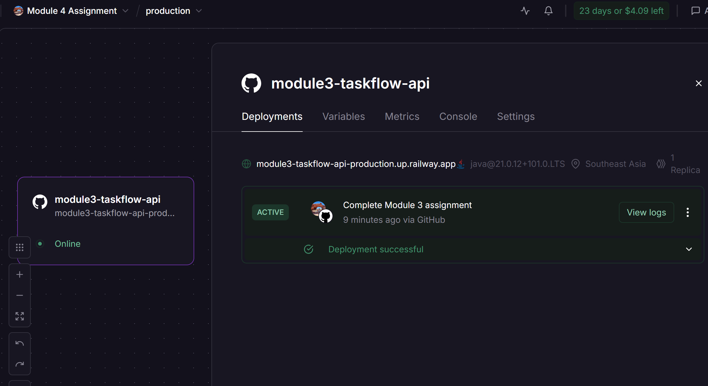
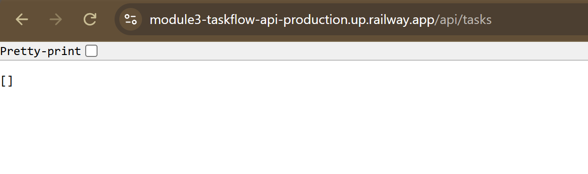
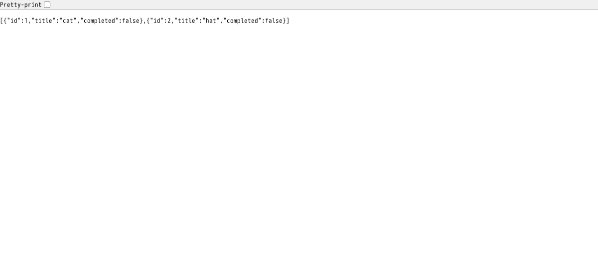
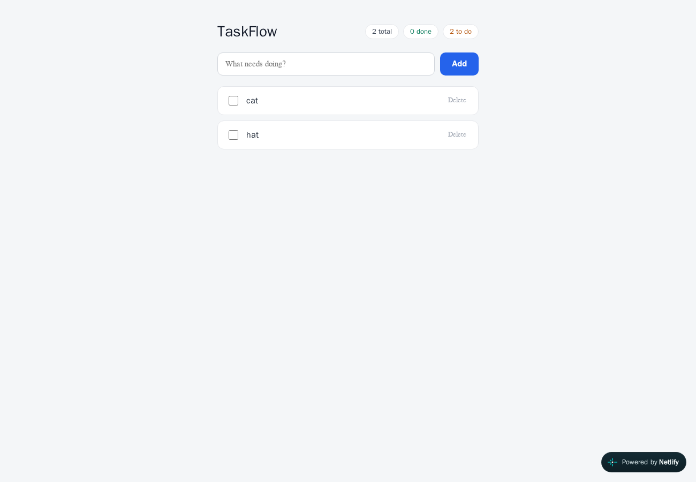
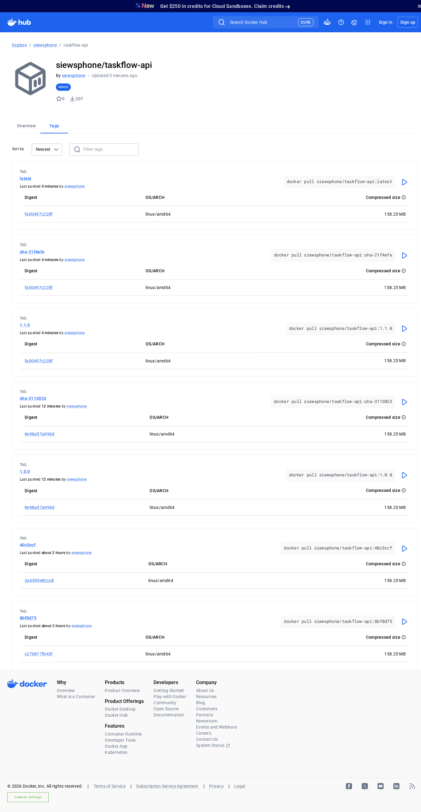

# TaskFlow API — Module 4: Dockerize & Deploy

**Live application:** <https://module3-taskflow-api-production.up.railway.app/api/tasks>

A Spring Boot 4 REST API for managing tasks, containerized with a multi-stage
Dockerfile and deployed to Railway.

---

## Live deployment





| | |
|---|---|
| **Live URL** | <https://module3-taskflow-api-production.up.railway.app/api/tasks> |
| **Platform** | Railway (region: Southeast Asia, 1 replica) |
| **Runtime** | Java 21 (`java@21.0.12`) |
| **Source** | Docker image `siewsphone/taskflow-api:latest`, built and published by the CircleCI pipeline below; Railway runs that image |
| **Build** | multi-stage `Dockerfile` in the project root |

---

## Task 1 — Dockerfile (multi-stage build)

The `Dockerfile` sits in the project root:

```dockerfile
# Stage 1: Build the JAR with Maven
FROM maven:3.9-eclipse-temurin-21 AS build
WORKDIR /app
COPY . .
RUN mvn clean package -DskipTests

# Stage 2: Run the JAR in a slim runtime image
FROM eclipse-temurin:21-jre-alpine
WORKDIR /app
COPY --from=build /app/target/*.jar app.jar
EXPOSE 8080
CMD ["java", "-jar", "app.jar"]
```

**Why two stages?** `target/` is listed in `.gitignore`, so the compiled JAR is
never pushed to GitHub. The CI pipeline builds the image from the source with
Maven *inside* stage 1. Stage 2 then copies only that one JAR into a small
Alpine JRE image and runs it — the Maven build toolchain (several hundred MB)
is discarded with the build stage and never ships to production.

A `.dockerignore` keeps `target/`, `.git/` and the IDE folders out of the build
context so the build stays fast.

---

## Task 2 — Build and test the image locally

```bash
# 1. Build the image
docker build -t taskflow:latest .

# 2. Run the container
docker run -p 8080:8080 taskflow:latest

# 3. Test it (second terminal)
curl http://localhost:8080/api/tasks
```

The first build takes a few minutes while Maven downloads dependencies.

> **Verification note.** Both stages of the Dockerfile were verified
> individually: `mvn clean package -DskipTests` was run and produced
> `target/taskflow-api-1.1.0.jar`, and that JAR was then started with
> `java -jar` on port 8080 and exercised with the full endpoint sweep below —
> which is exactly what Stage 2 does. The `docker build` / `docker run` commands
> themselves run in the CI pipeline on every push to `main` (Stretch goal,
> Option 1), which is a real Docker daemon executing the real `Dockerfile`.

---

## Task 3 — Deployed to Railway

1. Committed the `Dockerfile` and pushed to `main`.
2. Railway → **New Project** → deployed the TaskFlow service.
3. The service runs the published image
   `siewsphone/taskflow-api:latest` from Docker Hub, rebuilt by the CI
   pipeline on every push to `main`.
4. **Settings → Networking → Generate Domain**, target port **8080**.

---

## Task 4 — Verified the deployment

Every endpoint was exercised against the **live** Railway URL with `curl`
(the same requests the module documents in Postman, just scripted). Results:

| Method | Path | Status | Response |
|---|---|---|---|
| GET | `/api/tasks` | **200** | `[]` — list of tasks |
| POST | `/api/tasks` | **201** | `{"id":3,"title":"Live verify B","completed":true}` |
| GET | `/api/tasks` | **200** | array containing the created tasks |
| GET | `/api/tasks/{id}` | **200** | the requested task |
| GET | `/api/tasks/999999` | **404** | `{"message":"Task not found with id: 999999","timestamp":"..."}` |
| PUT | `/api/tasks/{id}` | **200** | updated task |
| PUT | `/api/tasks/{id}/complete` | **200** | `completed` flipped to `true` |
| GET | `/api/tasks/summary` | **200** | AI-generated summary of the tasks |
| DELETE | `/api/tasks/{id}` | **200** | task removed |
| GET | `/api/tasks/{id}` after delete | **404** | standard error shape |

The same sweep was run against the local build with the project's black-box test
script — **all 38 checks passed**, including the edge cases:

- a client-supplied `id` is ignored (the server assigns one)
- `"completed": null` is normalised to `false` rather than rejected
- a missing task returns **404**, not 500, with the shared error shape and no stack trace
- `/api/tasks/summary` is not swallowed by the `/api/tasks/{id}` template
- a retired id is never handed out again

The 404 path is the one worth highlighting: an absent id is an invalid request,
so it is a 404 — and it is produced by a single `@RestControllerAdvice` handler,
so no controller contains a `try/catch` and no stack trace ever reaches the client.

**Screenshots of the live application URL:**




The first was taken when the in-memory store was empty, which is why the body is
`[]`; the second is the same live URL with tasks present. The store lives in
memory, so it resets on every redeploy — an empty array is a healthy response,
not a failure. Both screenshots are the Railway URL, unmodified.

---

## Errors and failures

The brief asks for what went wrong, in plain terms.

**1. `docker build` / `docker run` were not executed on the authoring machine.**
It has the Docker CLI but no daemon, so `docker build` cannot run there at all.
Both stages were verified separately instead — Maven produced
`target/taskflow-api-1.1.0.jar`, and that JAR was started on port 8080 and passed
the 38-check endpoint sweep — and the real `docker build` + `docker push` runs in
CI on every push to `main`. The local Docker command is the one step that was not
run as written.

**2. The first CI deploy job failed with `could not find the CLI binary`.**
The job called `npx @railway/cli`, whose npm package downloads its real binary in
a `postinstall` script that CI's script policy skips. Railway's own installer
surfaced a second failure — it prompts
`Install railway to ~/.railway/bin? [y/N]` and exits 1 on a non-interactive
stdin. Fixed with `curl -fsSL cli.new | bash -s -- --yes`; the pipeline has been
green since.

**3. Three CI jobs reported success while doing nothing, because `halt` exits 0.**
The worst failure of the exercise, and it was silent. The dependency scan, the Snyk
gate and the deploy job each checked for a credential, printed instructions and called
`circleci-agent step halt` when it was missing. A halted step exits **0**, so all three
showed green. Consequences: the dependency scan had never actually scanned; the Snyk
gate had never actually gated (it only began working after `SNYK_TOKEN` was added - and
then immediately found 9 vulnerabilities); and the deploy had never actually deployed
for several pipelines, because the project variable was spelled `RAILWAY_SERVIEC_ID`
so the check for `RAILWAY_SERVICE_ID` never matched. The live service was running a
build from before the dependency upgrades the whole time, while the pipeline said
otherwise. Detected by comparing the live app against the pipeline: `/api/tasks` still
served data that only survives when no redeploy happens, and the live response had none
of the security headers the current commit adds. Fixed by making a missing deploy
credential exit non-zero rather than halt, and by adding a post-deploy step that polls
the live URL for a header that exists only in the current commit - so the job proves
the container was replaced instead of trusting the redeploy command's exit code.
Lesson: a failure that exits 0 is worse than a red build, because nobody looks at it.

**4. A bodyless `PUT /api/tasks/{id}` returned 500 with a leaked method signature.**
Found by the ZAP baseline scan, not by review. The catch-all handler returned
`"Something went wrong: " + ex.getMessage()`, so a PUT with no body answered 500 with
the controller's full signature on the wire:

```
"message":"Something went wrong: Required request body is missing: public
org.springframework.http.ResponseEntity<sg.edu.ntu.taskflowapi.model.Task>
sg.edu.ntu.taskflowapi.controller.TaskController.updateTask(java.lang.Long,
sg.edu.ntu.taskflowapi.model.Task)"
```

Package names, class names, method and parameter types — a public response describing
the server's internals, and the wrong status on top of it: a malformed request is a
client error. Fixed in `GlobalExceptionHandler`: `HttpMessageNotReadableException` maps
to **400** with fixed text, unknown routes to 404, and the catch-all logs the exception
server-side and returns `"Internal server error"`. Nothing derived from an exception
reaches a client any more.


---

## Stretch goals

Five stretch goals were completed. Each section below states what was built and links
to the evidence: **Option 1** CI pipeline, **Option 2** frontend on Netlify,
**Option 3** the Simple CRM route, **Option 4** versioned images, **Option 5** security
checks.

### Option 1 — CI pipeline (CircleCI): build → test → publish to Docker Hub → redeploy

`.circleci/config.yml` runs a single `build-test-publish` workflow on every push.
It is a **CI pipeline** running alongside the deployment: every green run
produces a fresh image in Docker Hub and then asks Railway to pull it.

**`build`** (runs on every branch, so a broken change is caught before it
reaches `main`):

1. Caches `~/.m2/repository`, keyed on a `pom.xml` checksum
2. `mvn -B clean package` — the test phase included, not `-DskipTests`
3. **Smoke-tests the packaged JAR** by booting it and asserting each endpoint's
   status code, including the failure path:

   ```
   PASS  GET  -> 200          PASS  PUT /1/complete -> 200
   PASS  GET /999999 -> 404   PASS  GET /1 -> 200
   PASS  POST -> created id 1 PASS  DELETE /1 -> 200
   PASS  PUT /1 -> 200        PASS  GET /1 -> 404
   PASS  GET /summary -> 200  PASS  GET /version -> 200 (reports 1.1.0)
   ```

   The project has no JUnit classes, so `mvn test` passes vacuously — this step is
   the pipeline's real test. It needs no model API key, because `/summary`
   short-circuits before calling the model when there are no tasks.

**`publish`** (only on `main`, only after `build` passes, so a failing change
can never reach the registry): builds from the repository's `Dockerfile` via
`setup_remote_docker` and pushes **three tags** — `latest` (the tag the Railway
service tracks), the SemVer version read from `pom.xml`, and `sha-<short SHA>`.
See [Option 4](#option-4--published-versioned-images) for why all three exist.

**`deploy`** (after `publish`): asks Railway to pull the new image via the Railway
CLI, installed with Railway's own installer because the npm package's
`postinstall` binary fetch is skipped by CI's script policy. It needs
`RAILWAY_TOKEN` and `RAILWAY_SERVICE_ID`, and — after a false green — it **fails**
rather than halts when either is missing: a deployment job that deploys nothing must
not report success. It then **proves the rollout landed** by polling the live URL for
a header that only exists in the current commit, so "deployed" is a measured fact and
not the exit code of a redeploy command. See
[Errors and failures](#errors-and-failures) item 3 for what that false green cost.

**Two more jobs run alongside**, both described in
[Option 5](#option-5--security-checks): `snyk_scan` + `snyk_code` gate `publish`, and
`dependency-scan` + `container-scan` (Trivy) report without gating.

**Credentials are not in the repository.** `DOCKER_USERNAME` and
`DOCKER_TOKEN` are read from a CircleCI **context** (`docker-hub`); the job
fails fast with a clear message if either is missing. The token should be a
Docker Hub access token with Read & Write scope, never the account password.

| | |
|---|---|
| Pipeline runs (newest first) | <https://app.circleci.com/pipelines/gh/siewsphone/module3-taskflow-api> |
| Image on Docker Hub | <https://hub.docker.com/r/siewsphone/taskflow-api> |

### Option 2 — Frontend on Netlify

**Live frontend: <https://ntu-taskflow.netlify.app>**

A small React single-page app that consumes the deployed TaskFlow API — no
local backend, every call goes to the live Railway URL.

| | |
|---|---|
| **Frontend URL** | <https://ntu-taskflow.netlify.app> |
| **Hosted on** | Netlify (static build of `frontend/`, folder `frontend/` in this repo) |
| **Stack** | Vite + React 19, state via Context + `useReducer` |
| **API calls** | `GET /api/tasks`, `POST /api/tasks`, `PUT /api/tasks/{id}/complete`, `PUT /api/tasks/{id}`, `DELETE /api/tasks/{id}` |

**What it does:** lists the tasks from the live API on load, adds new tasks,
completes and un-completes them, deletes them, and shows live counts
(total / done / to do). API failures surface a friendly banner with a retry
suggestion instead of a stack trace.

**CORS.** With the frontend on Netlify and the API on Railway, the browser
blocks every fetch until the API names the frontend's origin. Added
`src/main/java/sg/edu/ntu/taskflowapi/config/CorsConfig.java`:

```java
@Configuration
public class CorsConfig implements WebMvcConfigurer {

    @Override
    public void addCorsMappings(CorsRegistry registry) {
        registry.addMapping("/api/**")
                .allowedOriginPatterns("https://*.netlify.app", "http://localhost:5173")
                .allowedMethods("GET", "POST", "PUT", "DELETE", "OPTIONS");
    }
}
```

The pattern covers the deployed Netlify domain (and any future subdomain) plus
the Vite dev origin. Verified by booting the packaged JAR locally and checking
the preflight response:

```
OPTIONS /api/tasks  (Origin: https://ntu-taskflow.netlify.app)
  -> Access-Control-Allow-Origin: https://ntu-taskflow.netlify.app
     Access-Control-Allow-Methods: GET,POST,PUT,DELETE,OPTIONS
```



Captured from a real headless-browser session running on the Netlify origin
against the live Railway API — not a mock-up: the list rendered from
`GET /api/tasks`, a task was created through the form (`POST /api/tasks → 201`),
then deleted through the UI (`DELETE /api/tasks/{id} → 200`). No CORS error, no
console message, and the counters returned to their original state afterwards.
That is the end-to-end proof that the preflight response above is what the
deployed image really answers, not just what the local JAR answered.

### Option 3 — the Simple CRM projects

Option 3 is the alternative route: containerize and deploy the **Simple CRM** API and
its React frontend *instead of* TaskFlow. Both halves are live, and their full write-up
lives in the API repository, because that is where the Dockerfile, the database wiring
and the CORS configuration actually are:

| | |
|---|---|
| Live API (Railway) | <https://simple-crm-lite-production-4fe9.up.railway.app/customers> |
| Live frontend (Netlify) | <https://simple-crm-lite.netlify.app> |
| Full write-up | <https://github.com/siewsphone/simple-crm-lite#module-4--stretch-goal-option-3-simple-crm-deployed> |
| Image on Docker Hub | <https://hub.docker.com/r/siewsphone/simple-crm-lite> |

Short version of what that route involved, since the details are one click away:

- **Same multi-stage Dockerfile pattern**, but this API cannot run standalone —
  `application.properties` has no default datasource, so the container needs
  `SPRING_DATASOURCE_URL` / `_USERNAME` / `_PASSWORD` *and* a reachable Postgres before it
  will start. `docker-compose.yml` supplies both locally, gated on a database healthcheck.
- **Railway service variables** carry those three values; the service could not be
  serving requests otherwise, because there are no fallback defaults in code.
- **CORS** had to be added server-side: the Netlify origin calls the Railway origin
  directly, so the API answers the preflight with `Access-Control-Allow-Origin` and
  `expose-headers: Location`.
- **CI** runs `build → test → publish`, and the `test` job starts a real
  `cimg/postgres:16.0` service container — which is what makes it a genuine datasource
  test rather than a mocking exercise.
- Endpoints verified against the deployed URL: `GET /customers` 200, `POST` 201,
  `GET /customers/{id}` 200, `PUT` 200, `DELETE` 204, re-`GET` after delete 404.

### Option 4 — Published, versioned images

Every build publishes **three tags**, not just `latest`:

| Tag | Kind | Meaning |
|---|---|---|
| `latest` | moving | what the Railway service tracks; always the newest build |
| `1.1.0` | SemVer | `MAJOR.MINOR.PATCH` (Lesson 4.5), read from `pom.xml` |
| `sha-21f4efe` | immutable | short commit SHA of the build |

**The version is derived, never typed.** The publish job parses the project
version out of `pom.xml` — the first `<version>` *after* `</parent>`, so it
cannot pick up the Spring Boot parent's version instead — strips a `-SNAPSHOT`
suffix if present, and tags the image with it. Bumping `pom.xml` is therefore
the only way to publish a new number, and an image cannot claim a version the
code does not declare.

The SHA tag covers the opposite need: `latest` and `1.1.0` both move as new
builds land, but `sha-<commit>` always resolves to the build of that exact
commit. When something is broken in production, `sha-<commit>` is the tag that
identifies the binary you are actually looking at.

SemVer as practised here: MAJOR for breaking API changes, MINOR for new
endpoints, PATCH for fixes. `1.0.0` was the first release; `1.1.0` added
`GET /api/tasks/version`.

Each version came from a green pipeline run, so the tag is reproducible from the
run that produced it:

| Version | Pipeline | Commit |
|---|---|---|
| `1.0.0` | [#9](https://app.circleci.com/pipelines/gh/siewsphone/module3-taskflow-api/9) | `3113023` |
| `1.1.0` | [#10](https://app.circleci.com/pipelines/gh/siewsphone/module3-taskflow-api/10) | `21f4efe` |

**Verifiable at runtime.** That new endpoint reads the version from the JAR
manifest (the Spring Boot plugin copies the Maven version into it), so a
running container can say which tag it came from — no dashboard required:

```console
$ curl https://module3-taskflow-api-production.up.railway.app/api/tasks/version
{"version":"1.1.0"}
```

The CI smoke test asserts this and fails when the runtime version and the POM
version disagree. A versioned image that lies about its version is worse than an
unversioned one.

Two released versions in Docker Hub, with `latest` pointing at the newer:



The bare-SHA tags further down the page (`40c3ccf`, `8bf0d75`) are from the
earlier scheme, before the `sha-` prefix and the SemVer tags were added; they are
left in place as history rather than deleted.

### Option 5 — security checks

Six checks run against this repository, and each result below was read out of a CI run
rather than inferred from a green badge:

| Tool | Type | Role | Result on this repository |
|---|---|---|---|
| **Snyk** (`snyk_scan`) | SCA | **Gate** — HIGH/CRITICAL blocks `publish` | **9** issues in 123 dependencies → **0** after remediation |
| **Snyk Code** (`snyk_code`) | SAST | **Gate** | **0** issues |
| **OWASP Dependency-Check** (`dependency-scan`) | SCA | Watchdog — the tool the brief names | failed the build at CVSS ≥ 7 on **3 CPE matches**, investigated and resolved (see below) |
| **OSV-Scanner** (`osv-scanner.yml`) | SCA | Watchdog — weekly re-scan | 5 Maven + 115 npm packages → **no issues found** |
| **OWASP ZAP** baseline (`zap-baseline.yml`) | DAST | Watchdog — weekly | **0 FAIL, 2 WARN, 66 PASS** |
| **Trivy** (`container-scan`) | Container | Watchdog | **1 HIGH** in the base image → **0 HIGH / 0 CRITICAL** after the fix |

**Gates stop a release; watchdogs report and keep watching.** Snyk is the gate because
it runs on every push and `publish` requires it. OSV-Scanner and ZAP run on a schedule
as well as on push, because a CVE can be published against a dependency you have not
touched since the last scan, and ZAP can only see how the service behaves while it is
running. Trivy runs after `publish`, on the image that actually ships.

#### What the dependency gate caught

On its first run with a real token, `snyk_scan` scanned 123 dependencies and found
**9 issues across 4 packages** — and blocked `publish`:

| Package | Version found | Severity |
|---|---|---|
| `io.netty:netty-codec-http` | 4.2.17.Final | HIGH ×1 |
| `io.netty:netty-codec-classes-quic` | 4.2.17.Final | HIGH ×1 |
| `io.netty:netty-codec-http3` | 4.2.17.Final | HIGH ×5 |
| `org.apache.tomcat.embed:tomcat-embed-websocket` | 11.0.25 | HIGH ×1, **CRITICAL** ×1 |

Every one is **transitive** — none appears in `pom.xml`, so no diff review would have
found them. That is the argument for a gate over a careful reading of the POM.

Remediated through the property names Spring Boot's own `dependencyManagement` reads,
so each line moves as a unit instead of one jar being pinned while its siblings stay
behind: `spring-boot-starter-parent` 4.1.1 → **4.1.2**, `tomcat.version` 11.0.25 →
**11.0.27**, `netty.version` → **4.2.19.Final**, `spring-ai.version` 2.0.0 → **2.0.2**.
Re-scan: **124 dependencies, 0 issues, 0 vulnerable paths**. No severity threshold was
raised and no finding was ignored to make it pass.

**OWASP Dependency-Check is the tool the assignment names**, and it independently
reached the same conclusion on the same POM: the build failed with
`See the dependency-check report for more details` at `failBuildOnCVSS=7`. Two tools,
two advisory feeds, same verdict. It runs behind the `security` Maven profile with an
NVD cache, because a cold feed sync takes ~45 minutes.

#### What Dependency-Check caught — and what it got wrong

The brief's named tool failed the build with three packages at CVSS ≥ 7, and the
honest finding is that **none of them was a real vulnerability in this application**.
It flagged a set completely disjoint from Snyk's: `kotlin-stdlib 2.3.21`,
`kotlin-stdlib-common 1.9.10` and `spring-boot-devtools 4.1.2`.

Checking each against NVD rather than taking the score at face value:

- **`kotlin-stdlib` → CVE-2026-53914** is, per NVD, *"code execution ... via unsafe
  deserialization in the build cache metadata"* — a **compiler/build-tool** flaw. NVD
  scores it **6.7 MEDIUM**; Dependency-Check reported it as **9.8**, which is what
  crossed the `failBuildOnCVSS=7` threshold. The runtime stdlib jar does not contain
  the Kotlin build cache.
- **`kotlin-stdlib-common` → CVE-2020-29582** says *"before 1.4.21"* in NVD's own
  description, while the same record's CPE range is `versionEndExcluding 2.1.0` — which
  sweeps in 1.9.10. The two disagree, and the match came from the looser one.
- **`spring-boot-devtools`** is a development-time tool (auto-restart, LiveReload) that
  this API never uses. It was removed outright rather than suppressed.

The root cause is a matching model, not a defect: Dependency-Check maps a **JAR → CPE
(a product identifier) → CVE ranges for that product**, so a Maven library can inherit
an advisory for a build tool or a different artifact with a similar name. Snyk and
OSV match at the **package** level, with Maven coordinates and real version semantics.
Three independent sources agreed there is nothing here: OSV returns no advisory for
those exact coordinates, Snyk reported 0 issues across 124 dependencies, and Trivy
scanning `app/app.jar` in the built image reported **0 vulnerabilities**.

So the checks are complementary rather than redundant, and the disagreement was the
useful part — **Snyk caught what Dependency-Check missed** (seven Netty HIGHs and a
Tomcat CRITICAL, all transitive), and **Dependency-Check's own false positives forced
the investigation that confirmed the shipped jar is clean.**

Resolved as follows: `spring-boot-devtools` deleted from the POM; the three CPE matches
suppressed in [`dependency-check-suppressions.xml`](dependency-check-suppressions.xml)
with the NVD evidence quoted per entry; `failOnError=false` plus the .NET and OSS Index
analyzers disabled, because a missing analyzer in the build image is a property of the
image, not of the application.

#### What DAST caught

ZAP's baseline against the deployed app went **6 → 3 → 2 warnings** across three runs
while PASS rose **62 → 66**, with 0 failures throughout:

- **Fixed:** `X-Content-Type-Options`, `Strict-Transport-Security`,
  `Cross-Origin-Resource-Policy` (as `cross-origin` — `same-origin` would break the
  Netlify frontend), `X-Frame-Options`, CSP, `Cache-Control: no-store`
  (`SecurityHeadersFilter`)
- **Fixed, and this one mattered:** `Application Error Disclosure`. The catch-all
  exception handler returned `"Something went wrong: " + ex.getMessage()`, so a
  bodyless `PUT` answered **500** with the controller's full Java signature — package
  names, class names, method and parameter types — in a public response. Now
  `HttpMessageNotReadableException` maps to **400** with fixed text, unknown routes to
  404, and the catch-all logs server-side and returns `"Internal server error"`
- **Accepted:** `Re-examine Cache-control Directives` and `Non-Storable Content`, both
  consequences of `no-store` on live in-memory data — correct here, and left visible
  rather than suppressed with a ZAP rules override. A scanner taught to ignore things
  stops being a scanner

#### What the container scan caught

Trivy found **one HIGH in the base image**, not in this application's code:

```
taskflow-api:latest (alpine 3.24.3)  alpine  1 vulnerability
app/app.jar                          jar     0
brotli-libs  CVE-2026-111497  HIGH  fixed  1.2.0-r1 -> 1.2.1-r0
```

`app/app.jar` reading **0** is the point: everything the POM declares is clean, and the
finding lives in the alpine layer the JRE sits on — invisible to Snyk, OSV and
Dependency-Check, all of which read `pom.xml`. Fixed with `RUN apk upgrade --no-cache`
in the runtime stage; the rebuilt image scans **0 HIGH / 0 CRITICAL**. The Trivy binary
is pinned to 0.76.1 **and verified against the release SHA-256**, because Lesson 4.13's
case study is a scanner whose version tags were moved onto malicious code.

#### Reproducing the checks locally

```bash
snyk test --severity-threshold=high          # SCA, the same gate
snyk code test --severity-threshold=high     # SAST
NVD_API_KEY=... mvn verify -Psecurity        # OWASP Dependency-Check
trivy image --severity HIGH,CRITICAL siewsphone/taskflow-api:1.1.0
```

Method, before/after results and the accepted warnings in full:
[`SECURITY.md`](SECURITY.md).
